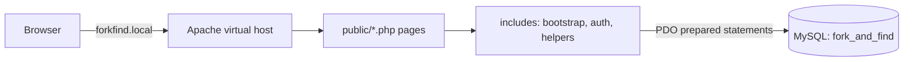

<div align="center">

# 🍴 Fork & Find

**Find the best meal in your department cafeteria, before you walk there.**

A campus cafeteria guide for PUCIT. Search meals, compare prices and ratings, read honest reviews. Cafeteria owners run their own menu. Admins keep it clean.


</div>

---

## Contents
- [Why Fork & Find](#why-fork--find)
- [Features](#features)
- [Project structure](#project-structure)
- [Roles and permissions](#roles-and-permissions)
- [How it works](#how-it-works)
- [Tech stack](#tech-stack)
- [Security](#security)
- [Database](#database)
- [Quick start](#quick-start)
- [Roadmap](#roadmap)
- [Team](#team)

## Why Fork & Find
Every department on campus has its own cafeteria, and there is no single place to see what is on the menu, what it costs, or whether it is any good. Students walk over, find an item sold out, or pay for something that turns out to be bad. Fork & Find puts the menus, prices, availability and student ratings of all department cafeterias in one searchable site.

## Features

| | Feature |
|---|---|
| 🔎 | **Meal search** by name, with a maximum price and a minimum star rating |
| 🏫 | **Cafeteria pages** with department, location, timings and the full menu |
| ⭐ | **Reviews and ratings** per menu item, with an average shown in search |
| ✏️ | **Own reviews only:** a student can update or delete their own review |
| 🚫 | **Sold-out toggle:** owners mark items unavailable in one click |
| 🛡️ | **Admin tools:** approve owners, assign owners to cafeterias, remove reviews |

## Project structure

```
fork-and-find/
├── config/
│   └── database.example.php     # copy to database.php (git-ignored)
├── database/
│   ├── schema.sql               # 4 tables
│   ├── sample_data.sql          # demo data
│   └── sample_data.php          # regenerates demo data with fresh hashes
├── docs/
│   ├── erd.md                   # ER diagram
│   └── forkfind.local.conf      # Apache virtual host
├── includes/
│   ├── bootstrap.php            # session, DB, CSRF check, shared setup
│   ├── auth.php                 # login helpers, requireLogin, requireRole
│   ├── helpers.php              # escaping, flash messages, CSRF helpers
│   ├── header.php
│   └── footer.php
├── public/                      # the only folder Apache serves
│   ├── index.php                # home
│   ├── search.php               # meal search
│   ├── cafeteria.php            # cafeteria page, menu and reviews
│   ├── login.php
│   ├── signup.php
│   ├── logout.php
│   ├── review_add.php
│   ├── review_delete.php
│   ├── admin/
│   │   ├── dashboard.php
│   │   ├── cafeterias.php
│   │   ├── owners.php
│   │   └── reviews.php
│   ├── owner/
│   │   ├── dashboard.php
│   │   ├── cafe_edit.php
│   │   ├── menu_form.php
│   │   ├── menu_delete.php
│   │   ├── menu_toggle.php
│   │   └── reviews.php
│   └── css/
│       └── style.css
├── .gitignore
├── README.md
└── SETUP.md
```

## Roles and permissions

| Action | Visitor | Student | Owner | Admin |
|---|:---:|:---:|:---:|:---:|
| Browse cafeterias and menus | ✅ | ✅ | ✅ | ✅ |
| Search meals | ✅ | ✅ | ✅ | ✅ |
| Write, update, delete own review | ❌ | ✅ | ❌ | ❌ |
| Edit own cafeteria info | ❌ | ❌ | ✅ | ✅ |
| Add, edit, delete own menu items | ❌ | ❌ | ✅ | ❌ |
| Mark own items sold out | ❌ | ❌ | ✅ | ❌ |
| Approve owner accounts | ❌ | ❌ | ❌ | ✅ |
| Add cafeterias, assign owners | ❌ | ❌ | ❌ | ✅ |
| Delete any review | ❌ | ❌ | ❌ | ✅ |

Owners sign up as pending and cannot log in until an admin approves them. Admin accounts cannot be created from the website.

## How it works



Only the `public/` folder is reachable from the browser. `config/` and `includes/` stay outside the web root.

## Tech stack
- **Backend:** PHP 8 with PDO
- **Database:** MySQL
- **Server:** Apache with a virtual host (`forkfind.local`)
- **Frontend:** HTML, CSS, JavaScript

## Security

| Protection | How it is done |
|---|---|
| Password storage | `password_hash()` on signup, `password_verify()` on login. Only hashes are stored. |
| SQL injection | PDO prepared statements for every query |
| Access control | `requireLogin()` and `requireRole()` on the server, plus ownership checks in SQL (for example `WHERE item_id = :id AND cafe_id = :owners_cafe`) |
| CSRF | A secret token in every POST form, checked in `bootstrap.php` with `hash_equals` |
| Sessions | Session ID regenerated on login, `HttpOnly` and `SameSite=Lax` cookies |
| XSS | All output escaped with `htmlspecialchars` |
| Login errors | One generic message for wrong email or wrong password |
| Database account | The app user has only SELECT, INSERT, UPDATE, DELETE on its own database |
| Secrets | `config/database.php` is git-ignored. Only an example file is committed. |

## Database
Four tables: `Users`, `Cafeterias`, `Menu_Items`, `Reviews`. See the full diagram in [docs/erd.md](docs/erd.md).

## Quick start
Full steps, including the Apache virtual host and troubleshooting, are in **[SETUP.md](SETUP.md)**. Short version:

```bash
git clone https://github.com/kamer-heap/FORK-and-FIND.git /var/www/forkfind
cd /var/www/forkfind
sudo mysql < database/schema.sql
sudo mysql < database/sample_data.sql
cp config/database.example.php config/database.php   # then set your DB password
```

Then set up the virtual host from [SETUP.md](SETUP.md) and open **http://forkfind.local**.

<details>
<summary>Demo accounts</summary>

Fake accounts for local testing only. Emails and passwords are generated by `database/sample_data.php`. Never use real passwords in this project.

</details>

<!--
## Screenshots
Uncomment after the UI is finished and add images to docs/screenshots/.

| Search | Cafeteria | Owner dashboard |
|---|---|---|
|  |  |  |
-->

## Roadmap
- [x] Database schema and sample data
- [x] Signup, login, role-based access
- [x] Student, owner and admin modules
- [x] CSRF protection
- [x] Update and delete own review
- [x] Apache virtual host setup
- [ ] UI/UX redesign
- [ ] Mobile layout polish
- [ ] Search by department

## Team

| | |
|---|---|
| **Hijab Ahmad** | [@hijabahmad-coder](https://github.com/hijabahmad-coder) |
| **Khadija Amer** | [@kamer-heap](https://github.com/kamer-heap) |

Built for the Web Technologies course at PUCIT.
