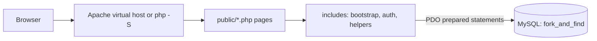

<div align="center">

# 🍴 Fork & Find

**Find the best meal in your department cafeteria, before you walk there.**

A campus cafeteria guide for PUCIT. Search meals, compare prices and ratings, and read honest reviews. Cafeteria owners run their own menu. Admins keep it clean.


</div>

---

## Contents
- [Why Fork & Find](#why-fork--find)
- [Features](#features)
- [Roles and permissions](#roles-and-permissions)
- [How it works](#how-it-works)
- [Project structure](#project-structure)
- [Tech stack](#tech-stack)
- [Security](#security)
- [Database](#database)
- [Quick start](#quick-start)
- [Roadmap](#roadmap)
- [Limitations](#limitations)
- [Team](#team)

## Why Fork & Find
Every department on campus has its own small cafeteria, each known for something different. They are not on Foodpanda or any other app, and Google Maps rates a whole place, not a single dish. Students walk around or ask friends, and hostel students find it hardest to know where the good, cheap food is.

Fork & Find puts the menus, prices, availability and student ratings of all department cafeterias in one searchable site, so a student can ask "where is the best biryani?" and get an answer.

| | Foodpanda | Google Maps | Fork & Find |
|---|:---:|:---:|:---:|
| Small department cafeterias | No | Some, no menu | Yes |
| Menu and prices | Big restaurants | Rarely | Yes |
| Review for each food item | No | No | Yes |
| Search "which department has biryani?" | No | No | Yes |

> **Variant 1 is a prototype.** It connects students with cafeterias. There is no ordering, payment or delivery yet (see the [roadmap](#roadmap)).

## Features

| | Feature |
|---|---|
| 🔎 | **Meal search** by name, with a maximum price and a minimum star rating |
| 🏫 | **Cafeteria pages** with department, location, opening days and timings, a photo and the full menu |
| 🍽️ | **Meal page** with photo, price, availability and all reviews for one item |
| ⭐ | **Reviews and ratings** per menu item, with an average shown in search |
| ✏️ | **Own reviews only:** a student can update or delete their own review |
| 📷 | **Photos:** owners upload a cafeteria photo and a photo for each of their meals |
| 🚫 | **Sold-out toggle:** owners mark items unavailable in one click |
| 🛡️ | **Admin tools:** approve owners, assign owners to cafeterias, remove reviews |

## Roles and permissions

| Action | Visitor | Student | Owner | Admin |
|---|:---:|:---:|:---:|:---:|
| Browse cafeterias and menus | ✅ | ✅ | ✅ | ✅ |
| Search meals | ✅ | ✅ | ✅ | ✅ |
| Write, update, delete own review | ❌ | ✅ | ❌ | ❌ |
| Edit own cafeteria info | ❌ | ❌ | ✅ | ✅ |
| Upload cafeteria and meal photos | ❌ | ❌ | ✅ | ❌ |
| Add, edit, delete own menu items | ❌ | ❌ | ✅ | ❌ |
| Mark own items sold out | ❌ | ❌ | ✅ | ❌ |
| Approve owner accounts | ❌ | ❌ | ❌ | ✅ |
| Add cafeterias, assign owners | ❌ | ❌ | ❌ | ✅ |
| Delete any review | ❌ | ❌ | ❌ | ✅ |

Owners sign up as pending and cannot log in until an admin approves them. Admin accounts cannot be created from the website.

## How it works



Every page starts with `includes/bootstrap.php`, which starts the session, connects to the database, loads the helpers and checks the CSRF token on every POST. Pages for owners and admins then call `requireRole()`. Only the `public/` folder is reachable from the browser. `config/` and `includes/` stay outside the web root.

## Project structure

```
fork-and-find/
├── config/
│   └── database.example.php     # copy to database.php (git-ignored)
├── database/
│   ├── schema.sql               # 4 tables (drops and recreates them)
│   ├── sample_data.sql          # demo data
│   └── sample_data.php          # regenerates sample_data.sql with fresh hashes
├── docs/
│   ├── erd.md                   # ER diagram
│   └── forkfind.local.conf      # Apache virtual host
├── includes/
│   ├── bootstrap.php            # session, DB, CSRF check, shared setup
│   ├── auth.php                 # login helpers, requireLogin, requireRole
│   ├── helpers.php              # escaping, flash messages, CSRF, default pictures
│   ├── cafe_extras.php          # opening days text and photo upload helpers
│   ├── brand.php                # logo
│   ├── header.php
│   └── footer.php
├── public/                      # the only folder Apache serves
│   ├── index.php                # home
│   ├── search.php               # meal search
│   ├── cafeteria.php            # cafeteria page and menu
│   ├── item.php                 # single meal page with reviews
│   ├── login.php
│   ├── signup.php
│   ├── logout.php
│   ├── student/
│   │   ├── my_reviews.php
│   │   ├── review_form.php
│   │   ├── review_add.php
│   │   └── review_delete.php
│   ├── owner/
│   │   ├── dashboard.php
│   │   ├── cafe_edit.php
│   │   ├── menu.php
│   │   ├── menu_form.php
│   │   ├── menu_delete.php
│   │   ├── menu_toggle.php
│   │   └── reviews.php
│   ├── admin/
│   │   ├── dashboard.php
│   │   ├── cafeterias.php
│   │   ├── owners.php
│   │   └── reviews.php
│   ├── css/
│   │   ├── style.css
│   │   ├── form.css
│   │   └── manage.css
│   ├── img/                     # default UI images and hero video
│   └── uploads/                 # demo photos (committed) and new uploads
├── .gitignore
├── README.md
└── SETUP.md
```

## Tech stack
- **Backend:** PHP 8 with PDO
- **Database:** MySQL
- **Server:** Apache with a virtual host (`forkfind.local`), or the PHP built-in server for quick local testing
- **Frontend:** HTML, CSS, JavaScript
- **Tools:** Git, GitHub, VS Code

## Security

| Protection | How it is done |
|---|---|
| Password storage | `password_hash()` on signup, `password_verify()` on login. Only hashes are stored. |
| SQL injection | PDO prepared statements for every query |
| Access control | `requireLogin()` and `requireRole()` on the server, plus ownership checks in SQL (for example `WHERE item_id = :id AND cafe_id = :owners_cafe`) |
| CSRF | A secret token in every POST form, checked in `bootstrap.php` with `hash_equals` |
| Sessions | Session ID regenerated on login, `HttpOnly` and `SameSite=Lax` cookies |
| XSS | All output escaped with `htmlspecialchars` |
| Input validation | Required fields, email format, length limits and positive prices are checked on the server |
| Login errors | One generic message for wrong email or wrong password |
| Photo uploads | The real file content is checked (JPG, PNG or WebP only, 2 MB max) and the file is saved under a random name |
| Database account | The app user has only SELECT, INSERT, UPDATE, DELETE on its own database |
| Secrets | `config/database.php` is git-ignored. Only an example file is committed. |

## Database
Four tables: `Users`, `Cafeterias`, `Menu_Items`, `Reviews`.

- One owner has one cafeteria.
- A cafeteria has many menu items.
- A menu item has many reviews.
- A student has at most one review per meal. A second submit updates it.

See the full diagram in [docs/erd.md](docs/erd.md). `database/schema.sql` is the single source of truth. It drops and recreates all four tables, so importing it again resets the data.

## Quick start
Full steps, including the database user, the Apache virtual host, photo uploads and troubleshooting, are in **[SETUP.md](SETUP.md)**. Short version:

```bash
git clone https://github.com/kamer-heap/FORK-and-FIND.git /var/www/forkfind
cd /var/www/forkfind
sudo mysql < database/schema.sql
sudo mysql < database/sample_data.sql
cp config/database.example.php config/database.php   # then set your DB password
php -S localhost:8000 -t public
```

Create the database user first, as shown in step 3 of [SETUP.md](SETUP.md). Then open **http://localhost:8000**.

The demo photos are stored in `public/uploads/` and their file names are included in `database/sample_data.sql`, so a fresh installation shows the right picture for every meal. Keep the folder and the seed data together.

> The database lives on your own computer and is not part of Git. After pulling new code, re-import `schema.sql` and `sample_data.sql` if the data looks different.

<details>
<summary>Demo accounts</summary>

Fake accounts for local testing only. Never use real passwords in this project. The sample data is generated by `database/sample_data.php`.

| Role | Email | Password |
|---|---|---|
| Admin | admin@forkfind.test | Admin@1234 |
| Owner | bilal@forkfind.test | Owner@1234 |
| Owner (pending approval) | pending@forkfind.test | Owner@1234 |
| Student | ayesha@forkfind.test | Student@1234 |

</details>

<!--
## Screenshots
Uncomment after the UI is finished and add images to docs/screenshots/.

| Search | Cafeteria | Owner dashboard |
|---|---|---|
|  |  |  |
-->

## Roadmap

**Variant 1: working prototype (this version)**
- [x] Database schema and sample data
- [x] Signup, login and role-based access (student, owner, admin)
- [x] Cafeteria pages, meal search with price and rating filters
- [x] Reviews and ratings per meal, update and delete own review
- [x] Owner tools: menu, prices, sold-out toggle, photos, opening days
- [x] Admin tools: approve owners, assign owners, remove reviews
- [x] CSRF protection, input validation and safe photo uploads
- [x] Apache virtual host setup

**Next improvements**
- [ ] Admin can upload cafeteria photos
- [ ] Search by department
- [ ] Mobile layout polish

**Later variants**
- [ ] Variant 2: pre-order and pickup time, cash on pickup
- [ ] Variant 3: delivery, online payment, notifications
- [ ] Variant 4: mobile app on Play Store, more universities

## Limitations
- Owners must keep their menus and prices up to date.
- Reviews can be biased. Later, only people who bought a meal should be able to review it.
- The prototype uses a few sample cafeterias and test data.
- It needs an internet connection.

## Team

| | |
|---|---|
| **Hijab Ahmad** | [@hijabahmad-coder](https://github.com/hijabahmad-coder) |
| **Khadija Amer** | [@kamer-heap](https://github.com/kamer-heap) |
