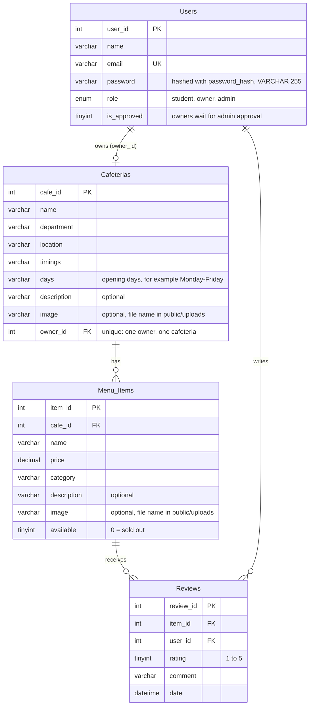

# Fork & Find - ER Diagram

Rules:
- A cafeteria has at most one owner (`owner_id` is unique and may be empty).
- A cafeteria cannot have two menu items with the same name.
- One review per student per menu item: a second submit updates it (`UNIQUE(item_id, user_id)`).
- When a cafeteria is deleted, its menu items and their reviews are deleted too.
